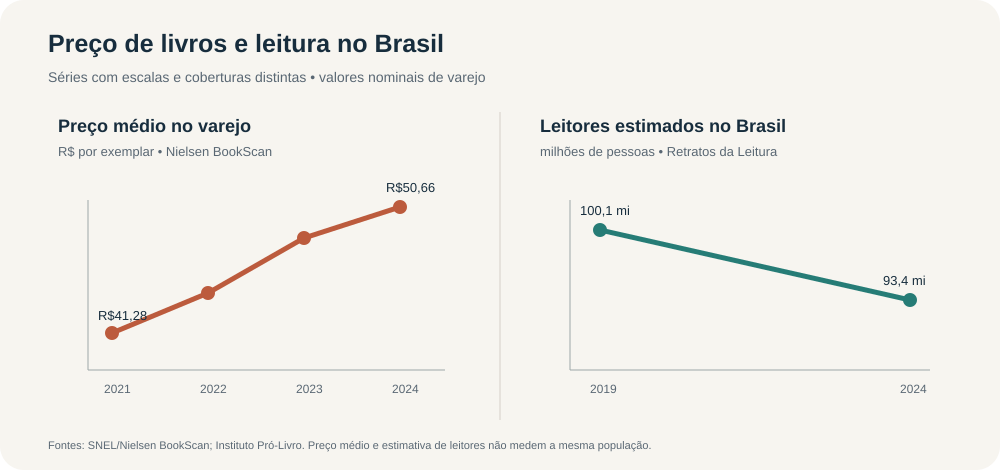

# O livro ficou mais caro? Preços, inflação e leitura no Brasil (2010–2024)

Projeto de pesquisa de dados sobre a evolução dos preços de livros impressos no Brasil, o custo de vida e os indicadores de leitura.

> **Resumo:** a percepção de que livros encareceram aparece nos dados recentes do varejo, mas a série editorial de longo prazo conta uma história diferente. As duas medidas têm universos distintos. Os dados brasileiros também mostram queda recente no número estimado de leitores; não encontrei uma série mundial comparável de leitores de livros.

## Pergunta

Como evoluíram os preços dos livros impressos no Brasil em relação à inflação e à renda, e como essa trajetória se relaciona com os hábitos de leitura?

## Principais achados

- O preço médio do varejo monitorado foi de **R$ 41,28 em 2021** para **R$ 50,66 em 2024**: alta nominal de 22,7% e alta real estimada de aproximadamente 5,8% após o IPCA acumulado de 2022–2024.
- Para **Obras Gerais**, o preço médio nominal editorial foi de **R$ 10,07 em 2010** e **R$ 20,17 em 2024**. Corrigindo o preço de 2010 pelo IPCA, o de 2024 fica cerca de 9,9% menor em termos reais.
- A estimativa de leitores no Brasil caiu de **100,1 milhões em 2019** para **93,4 milhões em 2024**.
- O peso do livro médio em relação ao salário mínimo ficou próximo de 3,5% entre 2021 e 2024, uma aproximação simples que não representa toda a distribuição de renda.

## Como interpretar

Preço de varejo, preço médio editorial e preço de capa não são a mesma coisa. A média do varejo muda conforme os livros vendidos, os descontos e a combinação de canais e gêneros. O painel público agrega livrarias, e-commerce e outros varejistas colaboradores, portanto não permite comparar diretamente loja física e compra online.

O indicador de leitor da pesquisa Retratos da Leitura considera quem leu ao menos parte de um livro impresso ou digital nos três meses anteriores. Alfabetização global não equivale a leitura de livros; por isso, o projeto não afirma que o número mundial de leitores esteja crescendo.

Os dados mostram movimentos simultâneos, mas não provam que preço causou aumento ou redução de leitores.

## Conteúdo do repositório

- [`data/dados.csv`](data/dados.csv): observações, cálculos e links das fontes.
- [`docs/relatorio.md`](docs/relatorio.md): resultados, métodos, ressalvas e referências.
- [`assets/indicadores.svg`](assets/indicadores.svg): visualização resumida.

## Fontes principais

- [Produção e Vendas 2010 — FIPE/CBL/SNEL, preço médio de Obras Gerais](https://www.infomoney.com.br/mercados/preco-medio-do-livro-cai-442-entre-2009-e-2010/)
- [Produção e Vendas 2024 — CBL/SNEL/Nielsen](https://cbl.org.br/wp-content/uploads/2025/05/Producao_e_Vendas_anobase_2024_imprensa.pdf)
- [Série histórica editorial 2006–2024](https://cbl.org.br/wp-content/uploads/2025/07/PT-PeV_SerieHistorica_anobase_2024.pdf)
- [Painel do Varejo — SNEL/Nielsen, fechamento 2024](https://snel.org.br/wp-content/uploads/2025/11/SNEL_13_2024_-_13T_2024.pdf)
- [Retratos da Leitura 2024 — Instituto Pró-Livro](https://www.prolivro.org.br/wp-content/uploads/2024/11/Apresentac%CC%A7a%CC%83o_Retratos_da_Leitura_2024_13-11_SITE.pdf)
- [IPCA — IBGE](https://www.ibge.gov.br/estatisticas/economicas/precos-e-custos/9256-indice-nacional-de-precos-ao-consumidoramplo.html?edicao=20932&t=series-historicas)
- [Alfabetização global — UNESCO UIS](https://www.uis.unesco.org/en/2026-education-data-refresh)

## Limitações

A série anual completa de varejo entre 2015 e 2020 não foi encontrada em formato homogêneo; valores isolados desse período são identificados na base por período ou cobertura. A comparação entre 2010 e 2024 usa uma medida editorial cuja pesquisa mudou de instituição responsável ao longo do tempo. Os valores e cálculos são descritos com suas respectivas ressalvas no relatório.

---

**Status:** relatório exploratório; última atualização em 18/10/2026.
